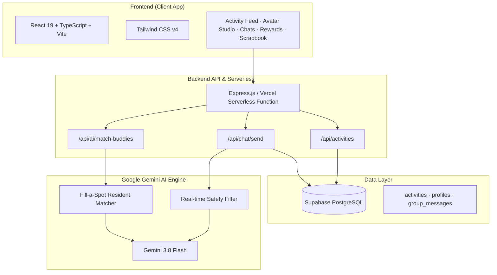

# 🏡 NeighbourBuddy

> **Empowering Connected, Active & Safe Residential Townships with Gemini AI**

NeighbourBuddy is an AI-powered hyperlocal community web platform tailored for residential townships, condominiums, and gated neighborhoods (such as City of Elmina / Sime Darby residential townships). It eliminates the social barriers of modern suburban living by connecting residents through sports, social activities, carpools, gamified engagement, and AI-moderated communication.

---

## 📌 Table of Contents

- [Problem Statement & Solution](#-problem-statement--solution)
- [Key Features](#-key-features)
- [System Architecture](#-system-architecture)
- [Tech Stack](#-tech-stack)
- [Project Structure](#-project-structure)
- [Getting Started](#-getting-started)
  - [Prerequisites](#prerequisites)
  - [Installation](#installation)
  - [Environment Variables](#environment-variables)
  - [Running Locally](#running-locally)
- [Deployment](#-deployment)
- [License](#-license)

---

## 🎯 Problem Statement & Solution

| Challenge in Modern Townships | The NeighbourBuddy Solution |
| :--- | :--- |
| **Urban Isolation & The "Polite Stranger" Gap**<br>Residents live next door for years without knowing who shares their interests or sports skill levels. | **Interest-Driven Communities & Precinct Profiles**<br>Find neighbors based on verified precincts (e.g. Precinct 2, Precinct 4), shared hobbies, and skill levels. |
| **"Plus-One" Friction in Sports & Meetups**<br>Hard to find that missing 4th doubles player for badminton or a running partner with a matching 5:30 min/km pace. | **AI "Fill-a-Spot" Matching (Gemini 3.8 Flash)**<br>Analyzes activity tier, availability, and preferences to automatically rank and recommend ideal buddy matches with explanation rationale. |
| **Safety & Privacy Hesitations**<br>Residents (especially women) worry about privacy, catfishing, or toxic group chats when meeting strangers. | **AI Content Moderation & Safe Spaces**<br>Gemini-powered real-time chat moderation for toxicity/harassment prevention, plus dedicated Women-Only activity tags and custom privacy avatars. |
| **Underutilized Township Amenities**<br>Clubhouses, badminton halls, central parks, and community gardens often sit vacant. | **Amenity Integration & Calendar Sync**<br>Direct booking perks, recurring activity schedules, and one-click `.ics` calendar sync for all events. |
| **Drop-Off in Long-Term Community Habit**<br>Neighborhood groups often lose momentum after a single event. | **Weekly Flame Streaks & Local Rewards**<br>Gamified check-ins, flame mascot milestones, and redeemable vouchers for local cafes, court passes, and organic garden produce. |

---

## ✨ Key Features

### 1. 🤖 AI-Powered "Fill-a-Spot" Matchmaking
* Powered by **Google Gemini 3.8 Flash** (`@google/generative-ai`).
* When an activity has open spots, the AI matches candidate residents by analyzing skill tier (e.g. *Intermediate Badminton: Rally & Rotations*, *Target Pace: 5:30 min/km*), precinct proximity, and schedule availability.
* Delivers match percentage scores (e.g., `95% Match`) and tailored reasons explaining why the pair will play well together.

### 2. 🛡️ Real-Time AI Chat Moderation
* Uses Gemini AI to review messages in real time before saving to the database.
* Intercepts hate speech, toxicity, and severe harassment to ensure neighborhood interactions remain welcoming and family-friendly.

### 3. 🏸 Hyperlocal Activity Hub & RSVP
* Browse and organize activities across 5 core categories: **Sports**, **Social**, **Hobbies**, **Carpool**, and **Women-Only**.
* Select pre-mapped township landmarks (*Elmina Central Park, Elmina Sports Complex, Elmina Lakeside Mall, Rainforest Center*) or drop custom location pins.
* One-click **Add to Calendar (.ics)** downloads event details directly to Apple Calendar, Google Calendar, or Outlook.

### 4. 💬 Interactive In-Chat Polls & Group Messaging
* Dedicated event chats keep logistics cleanly organized.
* Hosts can embed interactive polls directly in chat feeds (e.g., *"Warm-up preference before match play?"*, *"Post-run breakfast hangout spot?"*).
* Direct 1-on-1 private messaging to chat with matched buddies.

### 5. 🎨 Expressive Avatar Studio
* Custom avatar builder that protects resident privacy while celebrating identity:
  * 6 skin tones, 9 hairstyles & custom colors.
  * 7 facial expressions & moods (Smile, Sporty, Wink, Cool, Star-Eyes, etc.).
  * Gear & accessories (badminton rackets, running headbands, boba tea, medals, headphones, coffee cups).
  * Township jerseys and apparel with precinct badges.

### 6. 🔥 Gamification: Streaks & Flame Mascot
* Weekly participation tracking with an animated **Flame Mascot**.
* Streak milestones:
  * **Day 3 (Early Spark):** +20 Community Points.
  * **Day 7 (Township Explorer):** +50 Points & Sports Court booking priority.
  * **Day 14 (Kopi Master):** Free coffee coupon at township cafe hub.
  * **Day 30 (Township MVP):** MVP Crown badge & 1-hour court pass.

### 7. 🎁 Township Rewards Store
* Exchange earned community points for real-world township benefits:
  * ☕ *Central Cafe Heart Iced Latte* (120 pts)
  * 🏸 *1-Hour Sports Hall Court Booking* (200 pts)
  * 🥗 *Township Community Garden Fresh Veggie Basket* (180 pts)

### 8. 📸 Township Scrapbook & Photo Wall
* Community memory board with weekend hiking photos, inspirational quotes, sunset views, and community playlist highlights (Spotify cards).

---

## 🏗️ System Architecture



---

## 💻 Tech Stack

- **Frontend:**
  - [React 19](https://react.dev/) & [TypeScript](https://www.typescriptlang.org/)
  - [Vite 8](https://vitejs.dev/) for high-speed builds and hot module replacement
  - [Tailwind CSS v4](https://tailwindcss.com/) using `@tailwindcss/vite`
  - Lucide Icons & Custom SVG Avatars
- **Backend & APIs:**
  - [Node.js](https://nodejs.org/) & [Express 5](https://expressjs.com/)
  - [Google Generative AI SDK](https://github.com/google-gemini/generative-ai-js) (`@google/generative-ai`)
  - [Supabase JS](https://supabase.com/) (`@supabase/supabase-js`)
- **Deployment:**
  - [Vercel](https://vercel.com/) (Serverless configuration via `vercel.json`)

---

## 📁 Project Structure

```
NeighbourBuddy/
├── api/
│   └── index.js                 # Vercel serverless entry point
├── backend/
│   ├── src/
│   │   ├── config/
│   │   │   └── supabase.js      # Supabase client initialization
│   │   ├── services/
│   │   │   └── aiService.js     # Gemini 3.8 Flash matching & moderation logic
│   │   └── server.js            # Express API routes
│   └── package.json             # Backend dependencies
├── src/
│   ├── components/
│   │   ├── Avatar.tsx           # Avatar engine & SVG rendering
│   │   ├── AvatarStudio.tsx     # Custom avatar creation studio
│   │   ├── CommunitiesPage.tsx  # Hashtag-based township interest groups
│   │   ├── CommunityChatPage.tsx# Group chat rooms with shared resources
│   │   ├── CreateEventPage.tsx  # Event builder with venue & skill tiers
│   │   ├── EventChatPage.tsx    # Event group chat & live polls
│   │   ├── EventDetailsPage.tsx # Event overview, AI matching & calendar sync
│   │   ├── IndividualChatPage.tsx # Direct 1-on-1 buddy messaging
│   │   ├── PhotoWallPage.tsx    # Scrapbook memory wall & quotes
│   │   ├── RewardsPage.tsx      # Township rewards marketplace
│   │   ├── StreakModal.tsx      # Flame mascot streak modal
│   │   └── StreakPage.tsx       # Weekly streak progression & milestones
│   ├── services/
│   │   └── api.ts               # Frontend API client
│   ├── App.tsx                  # Main app navigation & state
│   ├── index.css                # Global styles & Tailwind v4
│   └── main.tsx                 # React entry point & page title
├── index.html                   # Shell HTML
├── package.json                 # Project dependencies & scripts
├── vite.config.ts               # Vite configuration
└── vercel.json                  # Vercel deployment rewrites
```

---

## 🚀 Getting Started

### Prerequisites

- [Node.js](https://nodejs.org/) (v18 or later recommended)
- `npm` or `pnpm`

### Installation

1. **Clone the repository:**
   ```bash
   git clone https://github.com/Nicholas22-NoIdea/NeighbourBuddy.git
   cd NeighbourBuddy
   ```

2. **Install frontend dependencies:**
   ```bash
   npm install
   # or
   pnpm install
   ```

3. **Install backend dependencies:**
   ```bash
   cd backend
   npm install
   # or
   pnpm install
   cd ..
   ```

### Environment Variables

Create a `.env` file in the `backend/` directory (or configure in your Vercel project dashboard):

```env
PORT=5000
SUPABASE_URL=https://your-supabase-project.supabase.co
SUPABASE_KEY=your-supabase-anon-or-service-key
GEMINI_API_KEY=your-google-gemini-api-key
```

> **Note:** If `GEMINI_API_KEY` is not provided, the backend automatically uses safe fallback data for demo and presentation purposes.

### Running Locally

1. **Start the Frontend Development Server:**
   ```bash
   npm run dev
   # or
   pnpm dev
   ```
   Open your browser at `http://localhost:8443` (or the port indicated in your console).

2. **Start the Backend API Server:**
   ```bash
   cd backend
   npm run dev
   ```
   The backend API will run on `http://localhost:5000`.

---

## 🌐 Deployment

NeighbourBuddy is configured for zero-configuration continuous deployment on [Vercel](https://vercel.com/):

- `vercel.json` automatically maps `/api/(.*)` requests to `api/index.js`.
- Add your `SUPABASE_URL`, `SUPABASE_KEY`, and `GEMINI_API_KEY` in **Vercel Project Settings > Environment Variables**.

---

## 📄 License

This project is open-source and available under the [ISC License](LICENSE).